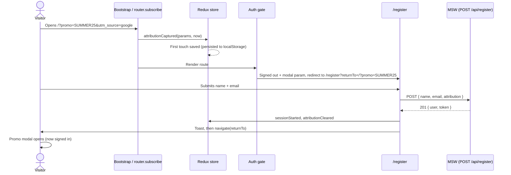

# Architecture

This folder is the source of truth for how the app is built. Each file covers one area. When code and these docs disagree, either the code is wrong or the doc needs updating in the same PR.

The task itself is described in [../Home Task - FE.docx](../Home%20Task%20-%20FE.docx) and summarised in the [root README](../../README.md).

**How these decisions were made:** see [architecture-decisions.md](architecture-decisions.md) for the process (architecture-advisor skill, cluster by cluster) and every question and answer.

## Context and constraints

| Constraint | Value |
| --- | --- |
| Platform | Web single-page app |
| Team | Solo |
| Scale | Demo only, run locally by reviewers |
| Time box | 1–2 hours of implementation |
| Budget | Free, open-source tooling only |
| Consistency | Attribution and session must stay correct across reloads and tabs |
| Backend | None. The API is mocked in the browser |

These constraints explain most of the "why" in the other docs. The goal is a small codebase where each requirement has one obvious home.

## Documents

| Doc | Covers |
| --- | --- |
| [architecture-decisions.md](architecture-decisions.md) | The process followed and every architecture question answered |
| [frontend.md](frontend.md) | Stack, folder structure, state ownership, app bootstrap |
| [routing-and-modals.md](routing-and-modals.md) | Routes, URL-driven modal stack, `openModal` / `closeModal` |
| [attribution.md](attribution.md) | Capturing `utm_*`, `ref`, `gclid`, `fbclid`; first-touch and 30-day rules |
| [auth.md](auth.md) | Mocked session, the two auth gates, redirect with `returnTo` |
| [api.md](api.md) | `POST /register` contract, errors, API client |
| [backend.md](backend.md) | MSW mock backend: handlers, behaviour, test reuse |
| [data-storage.md](data-storage.md) | `localStorage` keys, record shapes, versioning, cross-tab sync |
| [security.md](security.md) | Input validation, open-redirect protection, known limits |
| [testing.md](testing.md) | Test layers and the exact cases to cover |
| [delivery.md](delivery.md) | Git workflow, npm scripts, CI |

## The flow in one picture

## Decision summary

| Area | Decision | Doc |
| --- | --- | --- |
| Backend shape | MSW mocks the API inside the browser | [backend.md](backend.md) |
| Frontend shape | One SPA, organised by feature folders | [frontend.md](frontend.md) |
| Persistence | `localStorage`, versioned records | [data-storage.md](data-storage.md) |
| Auth mechanism | Session record from the register response, kept in Redux and `localStorage` | [auth.md](auth.md) |
| Authorization | Binary: signed in or not | [auth.md](auth.md) |
| Auth enforcement | Two central gates: `<ProtectedRoute>` and the root modal gate | [auth.md](auth.md) |
| Redirect | `/register?returnTo=…`, return there after sign-up | [auth.md](auth.md) |
| API | REST, single `POST /register`, nested `attribution` object | [api.md](api.md) |
| Modal state | The URL is the only source of truth; stack follows URL order | [routing-and-modals.md](routing-and-modals.md) |
| Attribution capture | Outside React: at bootstrap and on every `router.subscribe` event | [attribution.md](attribution.md) |
| Client state | Redux Toolkit: `auth` and `attribution` slices | [frontend.md](frontend.md) |
| Server state | React Query (`useMutation`) for the register call | [frontend.md](frontend.md) |
| UI library | MUI | [frontend.md](frontend.md) |
| Success side effects | Inside the `useRegister` hook | [frontend.md](frontend.md) |
| Failure handling | No automatic retry; keep attribution; show error | [api.md](api.md) |
| Validation | `returnTo` same-origin only; attribution key allowlist and length cap | [security.md](security.md) |
| Testing | Unit tests for rules, 1–2 integration tests with MSW | [testing.md](testing.md) |
| Delivery | npm scripts, README, GitHub Actions CI on every PR that touches code | [delivery.md](delivery.md) |

Deliberately out of scope: backups, file storage, scaling, messaging, background jobs, caching beyond React Query defaults, observability tooling, environments and release strategy, networking. None of them apply to a local demo with a mocked backend.

## Open questions

Decisions not yet made. Each is repeated in the doc it affects.

1. Should attribution older than 30 days still be sent on registration if no new params arrived? ([attribution.md](attribution.md))
2. Should there be a "Sign out" control so reviewers can re-test the signed-out flow? ([auth.md](auth.md))
3. How is the toast implemented: MUI `Snackbar` behind a small helper, or `notistack`? ([frontend.md](frontend.md))
